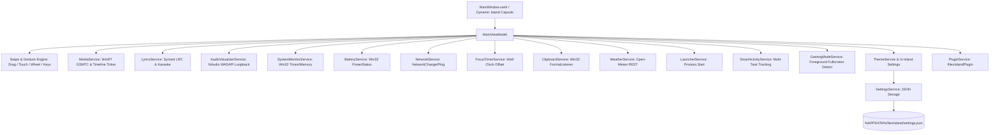

# NexIsland Architecture & Technical Specifications

## 1. Architectural Overview

NexIsland is built on the **Model-View-ViewModel (MVVM)** architectural pattern for WPF on .NET 8 LTS, augmented by asynchronous native Windows service bridges and a unified **Horizontal Swipe Navigation Engine**.



> [!NOTE]
> There is **no external Settings Window**. All configuration, theme personalization, module ordering, and system controls are seamlessly integrated directly into the Dynamic Island panel itself and auto-saved to disk.

---

## 2. Swipe Navigation Engine

NexIsland allows navigating through all 18 modules by simply swiping left or right:

```
Music ⇆ Lyrics ⇆ Visualizer ⇆ System ⇆ Battery ⇆ Network ⇆ Launcher ⇆ Controls ⇆ Notifications ⇆ Clipboard ⇆ Weather ⇆ Calendar ⇆ Focus ⇆ Activity ⇆ Gaming ⇆ FileDrop ⇆ Themes ⇆ Plugins
```

- **Mouse Drag**: Detects directional horizontal delta with an adjustable threshold (default 40px). Safe guard ignores gestures initiated on buttons, sliders, or text boxes.
- **Touchscreen**: Seamless swipe gesture detection via native pointer events.
- **Mouse Wheel / Trackpad**: Horizontal wheel scrolling or vertical scroll tilt smoothly transitions between modules with debounce protection.
- **Keyboard Navigation**: Left (`←`) and Right (`→`) arrow keys cycle through modules when the Island has focus.
- **Compact & Expanded Support**: Works in both compact pill mode and expanded dashboard mode.

---

## 3. Windows Interop & Core Services

### A. Windows Runtime GSMTC & Real-Time Timeline Ticker
- **Session Bridge**: Uses `GlobalSystemMediaTransportControlsSessionManager.RequestAsync()`.
- **Duration Bug Resolution**:
  - Windows GSMTC `GetTimelineProperties()` only provides a static snapshot at `LastUpdatedTime` and does not tick during continuous playback.
  - NexIsland solves this by combining `timeline.StartTime`, `timeline.EndTime`, and an active 250ms extrapolation ticker:
    $$\text{Position} = \text{RawPosition} + (\text{DateTimeOffset.UtcNow} - \text{LastTimelineUpdate})$$
  - When media sources do not provide duration or report `TimeSpan.Zero`, duration falls back safely to `--:--` instead of showing deceptive `00:00`.
  - Formats cleanly as `MM:SS` (or `H:MM:SS` for tracks exceeding 1 hour).
- **Interactive Scrubber & Seek**: Allows scrubbing and seeking directly using `TryChangePlaybackPositionAsync()`.

### B. Live Lyrics & Karaoke Engine (`LyricsService`)
- Parses standard LRC files matching `[mm:ss.xx] Lyrics text`.
- Compares real-time extrapolated playback position with lyric timestamps.
- Provides dynamic context: Active glowing line, previous context line, and next incoming line.

### C. Audio Visualizer (`AudioVisualizerService`)
- Powered by `NAudio.Wave.WasapiLoopbackCapture`.
- Captures system audio loopback without requiring microphone permission.
- Incoming 32-bit float audio buffers are processed across frequency bins with asymmetric smoothing (Fast Attack 0.6x, Smooth Decay 0.25x).
- Auto-sleeps during silence to conserve CPU.

### D. System Performance Monitoring (`SystemMonitorService`)
- **CPU Percentage**: Calculated using the differential formula from `GetSystemTimes`:
  $$\text{CPU \%} = \frac{(\Delta\text{Kernel} + \Delta\text{User}) - \Delta\text{Idle}}{\Delta\text{Kernel} + \Delta\text{User}} \times 100$$
  This avoids the massive thread overhead of `System.Diagnostics.PerformanceCounter`.
- **RAM Usage**: Extracted using `GlobalMemoryStatusEx` (`MEMORYSTATUSEX`).
- **Network Transfer Rate**: Computed by reading `NetworkInterface.GetAllNetworkInterfaces()` IPv4 statistics delta.

### E. Smart Battery (`BatteryService`)
- Real-time battery status using Win32 `GetSystemPowerStatus`.
- Distinguishes desktop AC power from laptop battery power.
- Automatic low-battery alerts and power transition notifications.

### F. Focus & Pomodoro Wall-Clock Precision (`FocusTimerService`)
- Uses wall-clock offset against `DateTime.UtcNow`:
  $$\text{Remaining} = \text{TargetEndTime} - \text{DateTime.UtcNow}$$
- Ensures 100% precision regardless of system sleep, window minimization, or OS thread suspension.

### G. Clipboard History (`ClipboardService`)
- Uses Win32 `AddClipboardFormatListener(hWnd)` and `WM_CLIPBOARDUPDATE`.
- Listens to clipboard broadcasts without polling or intrusive hooks.

### H. Smart Activity Island (`SmartActivityService`)
- Multi-task asynchronous progress tracker with cancellation and completion events.

### I. Gaming Mode (`GamingModeService`)
- Detects fullscreen processes and known game executables.
- Automatically reduces polling intervals (Eco profile) to ensure 0% impact on game FPS.

---

## 4. Spec-Aware Performance Modes

| Profile | Polling Interval | Visualizer Tick | Description |
| :--- | :--- | :--- | :--- |
| **Eco** | 3000 ms | 50 ms | Minimized CPU usage, tailored for low-spec laptops or battery operation |
| **Balanced** | 1000 ms | 33 ms | Standard responsive mode, silky 30 FPS transitions |
| **Performance (Turbo)**| 500 ms | 16 ms | Real-time gaming and high-frequency metrics |

---

## 5. Plugin Architecture

Plugins implement `INexIslandPlugin`:
```csharp
public interface INexIslandPlugin
{
    PluginMetadata Metadata { get; }
    bool IsEnabled { get; set; }
    Task InitializeAsync(IPluginContext context);
    Task StartAsync();
    Task StopAsync();
}
```
All plugin invocations are wrapped inside isolated try-catch boundaries, ensuring that third-party extensions cannot destabilize or crash the core dynamic island.
